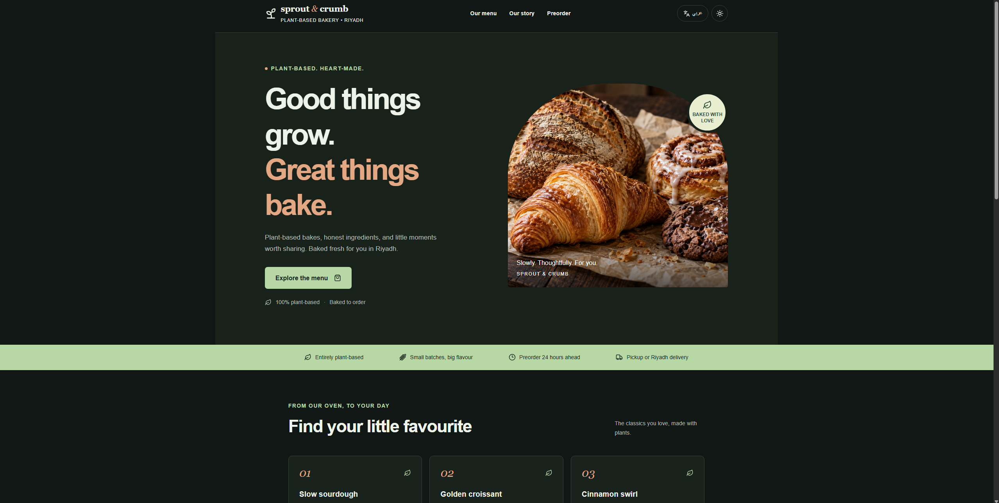
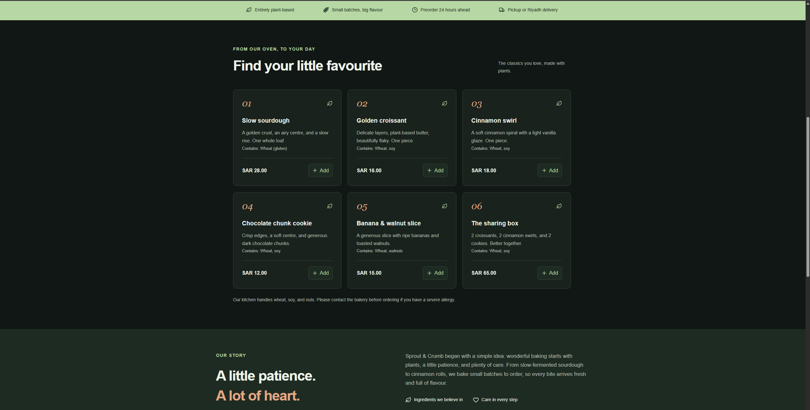
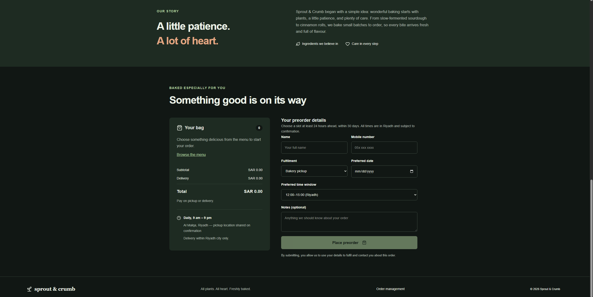

# Sprout & Crumb 🌱

### Bilingual Bakery Preorder & Order Management System

A full-stack, bilingual (Arabic/English) bakery preorder website built with **Next.js, React, TypeScript, and SQLite**.

The project features a responsive storefront, product catalog, shopping cart, preorder scheduling, and an admin dashboard for managing customer orders.

Designed as a portable application that runs locally on Windows without requiring external database services or cloud infrastructure.

---

## Project Overview

Sprout & Crumb is a plant-based bakery website designed to provide customers with a simple and intuitive online ordering experience.

The application supports both Arabic and English, including RTL and LTR layouts, and offers an end-to-end preorder workflow from product selection to order management.

The system uses a local SQLite database to store orders and can be deployed on another Windows computer with minimal configuration.

---

## Key Features

### Customer Storefront

- Responsive and modern user interface
- Arabic and English language support
- Right-to-left (RTL) and left-to-right (LTR) layouts
- Light and dark theme support
- Product catalog with descriptions and prices in SAR
- Shopping cart with order totals
- Preorder scheduling with preferred dates and time windows
- Bakery pickup and local delivery options
- Customer contact information and optional order notes

### Admin Dashboard

- Admin authentication
- Customer order management
- Order status management
- Local SQLite-based data storage
- Private configuration of administrator credentials

### Deployment & Portability

- Runs locally on Windows
- Automated setup using a Windows startup script
- No external database server required
- No cloud infrastructure required
- Local database storage
- Supports access from other devices on the same network when configured

---

## Project Screenshots

### Homepage

The main storefront introduces the bakery brand and provides easy access to the product menu and preorder features.



### Product Menu

An interactive product catalog displaying bakery products, descriptions, prices, and add-to-cart functionality.



### Preorder System

Customers can review their shopping bag, enter contact details, choose pickup or delivery, and select their preferred date and time.



---

## Technologies Used

| Category | Technologies |
|---|---|
| Frontend | Next.js, React, TypeScript |
| Styling | CSS, Responsive Design |
| Backend | Node.js, Next.js API Routes |
| Database | SQLite |
| Authentication | Admin Login, Password Hashing, Sessions |
| Deployment | Windows, Node.js |
| Development | Git, GitHub |

---

## System Architecture

The application follows a full-stack architecture using Next.js.

```text
Customer / Admin
       |
       v
Next.js Web Application
       |
       +-- Customer Storefront
       |     |
       |     +-- Product Catalog
       |     +-- Shopping Cart
       |     +-- Preorder Form
       |
       +-- Admin Dashboard
       |     |
       |     +-- Admin Authentication
       |     +-- Order Management
       |     +-- Order Status Updates
       |
       v
Next.js API Routes
       |
       v
SQLite Database
(data/bakery.db)
```

The frontend communicates with backend API routes, which handle requests and interact with the local SQLite database.

---

## Getting Started

### Prerequisites

- Windows 10 or Windows 11
- Node.js 22 LTS or newer
- npm (included with Node.js)

### 1. Clone the Repository

```bash
git clone https://github.com/bandar-farhan/sprout-and-crumb.git
cd sprout-and-crumb
```

Alternatively, download the repository as a ZIP file and extract it.

### 2. Install Dependencies

```bash
npm ci
```

### 3. Start the Application

On Windows, double-click:

```text
start-windows.cmd
```

The startup script installs dependencies when necessary, creates the local database, builds the application, and starts the server.

Open the website at:

```text
http://localhost:3002
```

Other devices on the same network can access the application using:

```text
http://SERVER-IP:3002
```

Network access requires allowing TCP port 3002 through Windows Firewall.

---

## Admin Configuration

The repository does not include administrator credentials, passwords, session secrets, or private environment files.

To configure an administrator account, open PowerShell in the project directory and run:

```powershell
@{ email = "owner@example.com"; password = "a-strong-password" } | ConvertTo-Json -Compress | node .\scripts\configure-admin.mjs
npm run build
```

Replace the example email and password with your own secure credentials.

The configuration script creates a private `.env` file that is excluded from Git.

The administrator password is stored as a salted hash rather than plaintext, along with a generated session secret.

---

## Database

The application uses **SQLite** for local data persistence.

The database is automatically created at:

```text
data/bakery.db
```

The database stores order information and login-attempt counters.

Database structure is defined in:

```text
database/schema.sql
```

No MySQL installation, external database server, or cloud database is required.

---

## Backup & Data Management

Before backing up or transferring an existing installation:

1. Stop the application.
2. Copy the complete project folder.
3. Include the local database and private configuration files.

Important files:

- `data/bakery.db` — Order records and login-attempt counters
- `.env` — Administrator configuration and session secret
- `public/` — Website images and static assets

SQLite may temporarily create `bakery.db-wal` and `bakery.db-shm` files while the application is running.

Stop the application before copying to ensure pending database changes are included in the backup.

**Never upload backups containing customer information or administrator credentials to a public repository.**

---

## Development Commands

Install dependencies:

```bash
npm ci
```

Start development mode:

```bash
npm run dev
```

Build the application:

```bash
npm run build
```

Start the production build:

```bash
npm start
```

The application runs on port **3002**.

---

## Customization

The project is designed to allow modifications to bakery content, products, prices, and visual design.

| File | Purpose |
|---|---|
| `lib/bakery.ts` | Products, prices, bakery information, hours, delivery fees, and order statuses |
| `app/storefront.tsx` | Arabic and English storefront content |
| `app/globals.css` | Styling, responsive layout, and themes |
| `app/admin/panel.tsx` | Administrator dashboard interface |
| `database/schema.sql` | SQLite database schema |
| `scripts/configure-admin.mjs` | Administrator configuration |

Product information, address, opening hours, and menu prices are starter content and should be customized before using the application for real orders.

---

## Project Highlights

This project demonstrates practical experience in:

- Full-stack web development
- Responsive user interface design
- Internationalization and RTL/LTR support
- API development
- SQL database integration
- Authentication and session management
- Local deployment and application portability
- End-to-end order management workflows

---

## Security Notes

- Administrator credentials are not included in the repository.
- Private environment files are excluded from Git.
- Passwords are stored using salted hashing.
- Session secrets are generated during administrator configuration.
- Local databases containing customer information should not be committed.
- Network access should only be enabled in trusted environments.

The application is intended as a project demonstration and local deployment solution. Production deployment requires appropriate security, hosting, backup, and operational reviews.

---

## Author

**Bandar Farhan**

Data Science Graduate | AI Engineering | Machine Learning | Full-Stack Development

[GitHub](https://github.com/bandar-farhan) · [LinkedIn](https://www.linkedin.com/in/bandar-farhan)

---

## Project Status

Functional portfolio project demonstrating bilingual storefront development, preorder processing, local data storage, and administrative order management.
